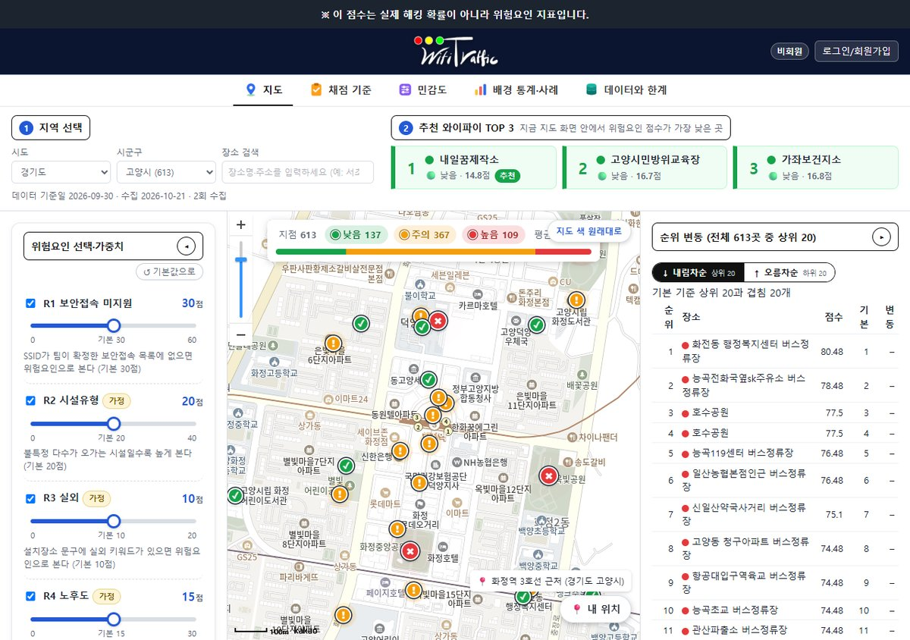
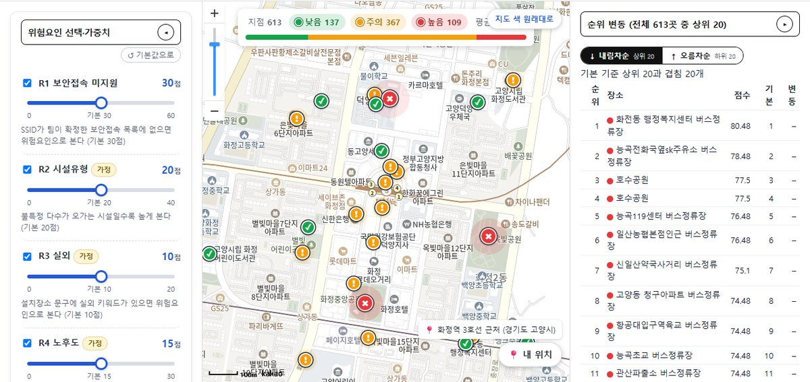
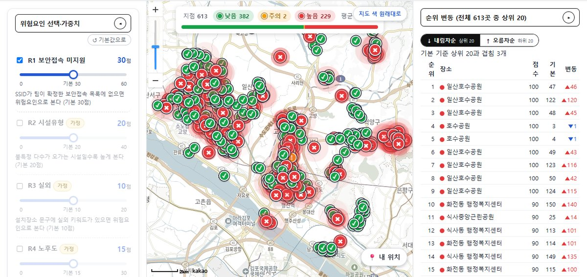
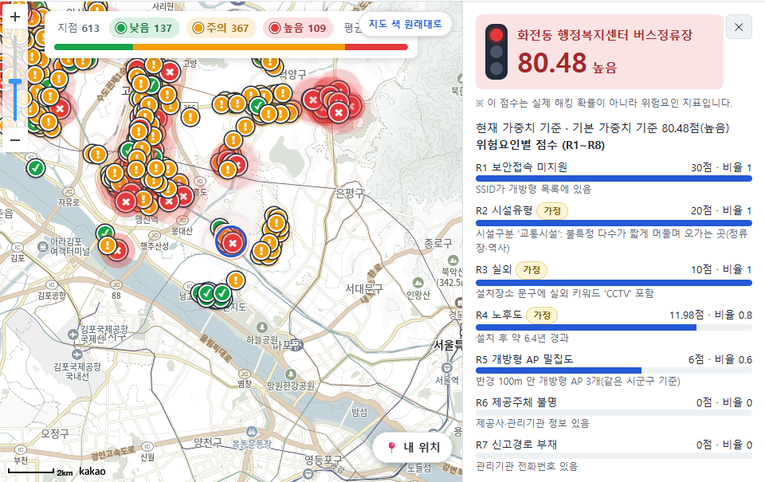
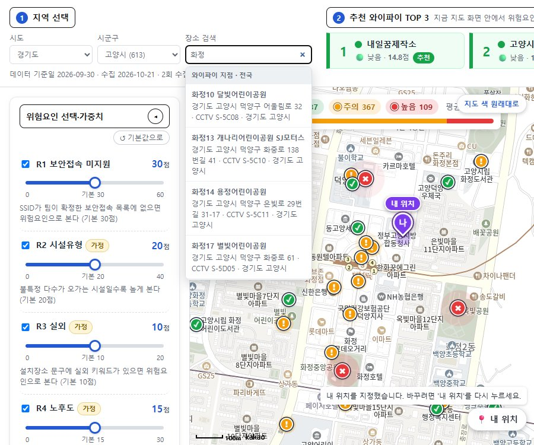
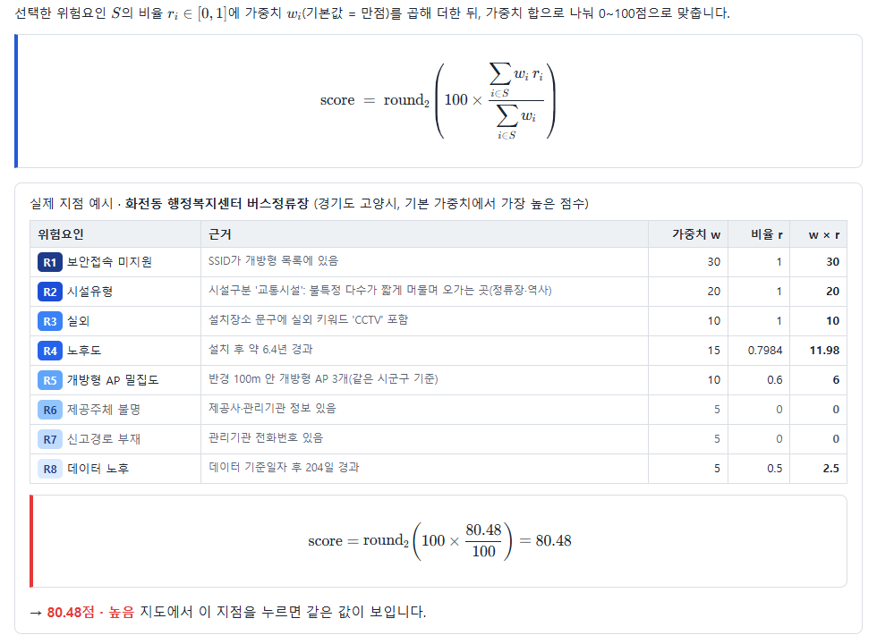
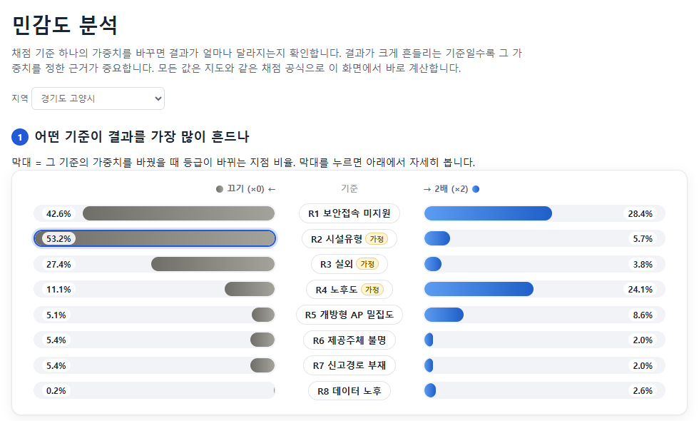
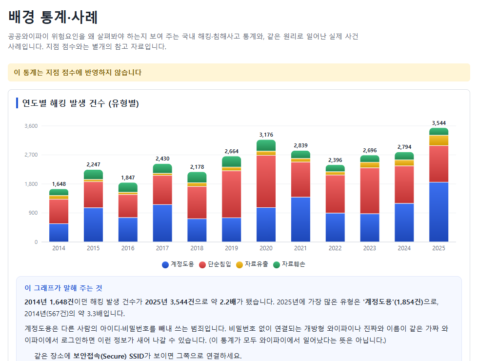
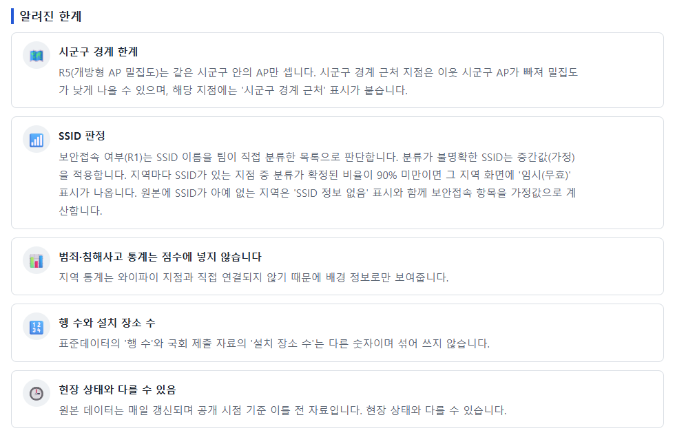
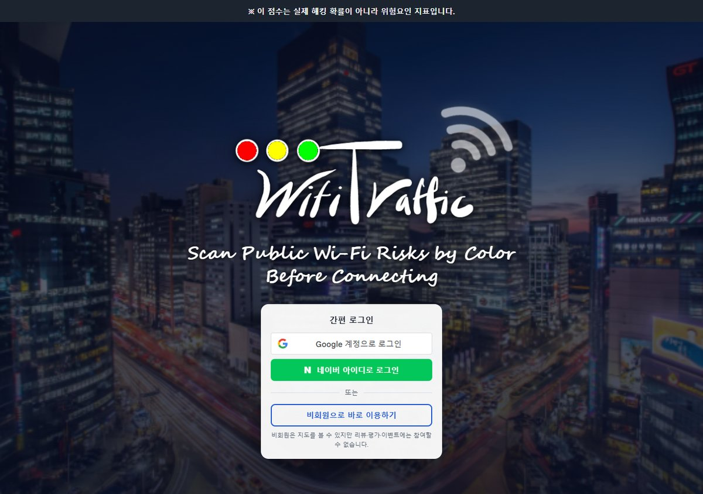

# 공공와이파이 안전 지도 (Wifi Traffic)

> **※ 이 지도의 점수는 실제 해킹 확률이 아니라 위험요인 지표입니다.**

전국 공공와이파이 지점마다 위험요인 점수(0~100)를 매겨 지도에 색으로 표시하고, 가중치 슬라이더로 채점 기준을 직접 바꿔 볼 수 있는 웹사이트. 설계 문서는 [plan.md](plan.md).



| 배포 | 주소 |
|---|---|
| 화면 | https://wifi-traffic.vercel.app |
| API | https://wifi-traffic-api.vercel.app (API 목록 `/docs`) |

시연 순서와 백업 전환은 [docs/demo_script.md](docs/demo_script.md).

## 주요 기능 (2026-10-21 기준)

**기준을 바꾸면 지도 색과 순위가 바로 바뀝니다.** 보안접속(R1)·밀집도(R5)만 남기고 나머지 6개를 끄면 고양시는 낮음 382 · 주의 2 · 높음 229가 되고, 기본 기준 상위 20곳 중 3곳만 남습니다.

**기본 기준 (8개 모두)** — 낮음 137 · 주의 367 · 높음 109



**보안접속(R1)·밀집도(R5)만** — 낮음 382 · 주의 2 · 높음 229, 순위표 변동 표시



| 지점 상세 — R1~R8 근거와 점수 | 장소 검색과 '내 위치' 핀 |
|---|---|
|  |  |
| **채점 기준** — 수식과 실제 지점 예시 계산 | **민감도 분석** — 기준별 등급 변경 비율 |
|  |  |
| **배경 통계·사례** — 점수에 반영하지 않음 | **데이터와 한계** — 알려진 한계 |
|  |  |

<details>
<summary>인트로·로그인 화면</summary>


</details>

화면은 배포 주소에서 비회원·경기도 고양시 기준으로 2026-10-21에 촬영했습니다. 지도는 축척 100m로 맞췄습니다(화정역 주변, 지점 상세는 1위 지점 주변). 요약 수치와 순위표는 고양시 전체 613곳 기준입니다.

| 화면 | 기능 |
|---|---|
| `/` | 구글·네이버 로그인(서버 검증) 또는 비회원, 처음 로그인하면 사는 지역 선택 |
| `/map` | 카카오맵 위 지점별 신호등 마커(낮음 ✓·주의 !·높음 ×, 같은 좌표 AP는 마커 1개·상세에서 전환, 마우스를 올리면 이름·최저 점수), 가중치 슬라이더·기준 끄기, 등급 필터, 화면 안 추천 TOP 3(같은 이름 1개), 순위표(위·아래 20곳), 지점 상세(R1~R8 근거·자동 설명), 전국 장소·주소 검색, '내 위치'(지도를 눌러 직접 지정), 최근 추가·삭제 레이어, 지도 색 흐리게/원래대로 |
| `/rules` | 채점 수식(KaTeX), 100점 구성, 위험요인 카드 8장, 실제 지점 예시 계산 |
| `/sensitivity` | 8개 기준 × 끄기/2배 토네이도 차트, 등급 흐름도, 상위 20곳 유지율(브라우저에서 계산) |
| `/context` | 경찰청 해킹 발생·KISA 침해사고 통계(점수 미반영), 같은 원리 사례 카드 4건 |
| `/about` | 데이터 출처, 가정, 알려진 한계 |

- 전국 228개 시군구 제공(`APP_MODE=dev`): SSID 라벨 확정 125곳, '임시(무효)' 45곳, 'SSID 정보 없음' 58곳 (2026-10-21 수집, requests #42)
- API가 응답하지 않으면 정적 번들(고양·서초·구로)로 자동 전환, 5분 뒤 자동으로, 또는 불러오기 실패 안내의 '다시 시도' 버튼으로 API 복귀

## 검증과 알려진 한계

- **R1(SSID 보안) 검증**: 상위 SSID 96개를 사람이 확정(SSID 있는 행의 95.1%). `Public WiFi Free`만 적힌 칸은 불명(0.5)으로 두고(#47), WiGLE 표본 조회(일일 한도로 1곳만 판단 가능)와 대전 서구 둔산동 현장 확인으로 `Public_WiFi_Free`를 secure로 확정(#48) — [docs/wigle_validation.md](docs/wigle_validation.md)
- **R5 시군구 경계**: 밀집도 점수는 같은 시군구 AP만 센다. 전국 데이터로 이웃 시군구 AP가 반경 안에 있는 지점을 찾아 `R5_boundary` 표시만 붙인다(점수 보정 없음)
- 범죄·침해사고 통계와 사례는 점수에 넣지 않는다. 표준데이터 '행 수'(2026-10-20 스냅샷 94,166)와 국회 제출 '설치 장소 수'는 섞어 쓰지 않는다
- 원본(LOCALDATA)은 2일 전 기준이라 현장과 다를 수 있다(현장 확인에서 등록된 `DJ_Public_WiFi`가 잡히지 않은 정류장 3곳)
- 결정 기록 전체: [docs/requests.md](docs/requests.md)

| 폴더 | 담당 | 내용 |
|---|---|---|
| [contracts/](contracts/README.md) | A | API 계약: JSON Schema 10종, mock 번들, 골든 테스트 |
| [backend/](backend/) | A | 수집·정제·채점 파이프라인, 매일 수집(Neon), FastAPI(Vercel), 정적 번들 생성 |
| [web-draft/](web-draft/) | A | HTML/CSS/JS 정적 초안 (시안·백업 데모) |
| [frontend/](frontend/README.md) | B(인계: [docs/handoff_B.md](docs/handoff_B.md)) | Next.js 앱 (카카오맵) |
| [scripts/](scripts/) | A | 번들 동기화, 면책 문구 검사 |
| [.github/workflows/](.github/workflows/daily-sync.yml) | A | 매일 KST 05:00 자동 수집 → Neon |
| [docs/](docs/) | | 진행 기록, 승인 요청, 발표·시연 문서 |

## 실행 방법

### 운영 구조 (docs/requests.md #15~#19)
```
GitHub Actions(매일 05:00) → LOCALDATA 전국 CSV → 정제·채점 → Neon(Postgres+PostGIS)
Next.js(frontend, Vercel) → 우리 API(Vercel FastAPI·sin1, Neon 읽기) — 응답 없으면 정적 번들(public/data)로 자동 전환
```

```bash
# ── 백엔드 ──
cd backend
python -m venv .venv && source .venv/bin/activate   # Windows: .venv\Scripts\activate
pip install -r requirements-pipeline.txt            # 수집·채점·테스트 (API만이면 requirements.txt)
cp .env.example .env                                # DATABASE_URL(Neon), SESSION_SECRET, DEV_LOGIN=1(로컬) 등

# Neon(DB) 경로 — 매일 수집과 같은 처리
python pipeline/db_migrate.py                        # 스키마·PostGIS (여러 번 실행해도 안전)
python pipeline/daily_sync.py                        # 원본 다운로드 → 정제·채점 → 전 지역 문서를 DB에 (약 5분)
python pipeline/export_bundle_from_db.py --regions 41-goyang,11-seocho,11-guro --default 41-goyang   # 시연 직전 정적 백업 번들 → bash scripts/sync_bundle.sh

# 파일 경로 — DB 없이 로컬 확인용(기존 방식)
python pipeline/ingest_snapshot.py ~/Downloads/무료와이파이정보.csv
python pipeline/census.py && python pipeline/clean.py
python pipeline/score.py --region 11-seocho,11-guro
python pipeline/changes.py && python pipeline/sensitivity.py --region 11-seocho,11-guro
python pipeline/pregen_explanations.py --region 11-seocho,11-guro --template-only
python pipeline/export_bundle.py --regions 11-seocho,11-guro --default 11-seocho

uvicorn api.main:app --reload --port 8000           # API: DATABASE_URL 있으면 Neon, 없으면 dist/data(없으면 mock)
cd .. && bash scripts/sync_bundle.sh                # dist/data → web-draft/data, frontend/public/data

# ── Next.js (frontend/README.md) ──
cd frontend && npm install && cp .env.local.example .env.local && npm run dev   # http://localhost:3000

# ── 정적 초안 (백업 데모) ──
cd web-draft && python -m http.server 5500          # http://localhost:5500  (?data=mock 으로 mock)

# ── 테스트 ──
cd backend && python -m pytest -q                   # DB 테스트까지: TEST_DB=1 python -m pytest -q
cd frontend && npm test                             # golden 51건
node web-draft/tests/score.test.mjs
python scripts/check_disclaimer.py
```

mock 번들 다시 만들기: `python backend/pipeline/make_mock.py` (golden도 mock 기준으로 재생성).

## 데이터 출처

| ID | 데이터 | 용도 |
|---|---|---|
| D1 | 전국무료와이파이표준데이터 ([15013116](https://www.data.go.kr/data/15013116/standard.do)) — 자동 수집은 [LOCALDATA 파일](https://file.localdata.go.kr/file/free_wifi_info/info) | 지점 원장, 채점 입력 |
| D2 | 서울특별시 구로구 공공와이파이 ([15147901](https://www.data.go.kr/data/15147901/fileData.do)) | R1 검증용으로 받았으나 `wifi접속환경` 칸이 없어 사용 못 함(#12) → R3 검증은 서울 API(#28, 키 대기), R1 검증은 WiGLE·현장 확인 |
| D3~D5 | 경찰청 사이버범죄 통계, KISA 침해사고 통계 | 배경 패널(**점수 미반영**) |
| D6 | 뉴스 기반 사례 카드 (`backend/data/cases.yaml`) | "같은 원리 사례 — 국내 공공와이파이 사건 아님" |

지도: Next.js는 카카오맵, 정적 초안은 OpenStreetMap(© OpenStreetMap contributors) 또는 카카오맵. 범죄 통계는 점수에 넣지 않는다.
